# HW 1

Due Thursday, September 3rd at 11:59 pm.

1. Save your answers in a GitHub repository named `stats`. Under `Setting` in the GitHub repository, set me (`rweigel`) as a collaborator.
2. Save your answers in the following format:
   1. Save code as `HW1_X.ext`, where `X` is the problem number and `ext` is the extension (e.g., `py` or `m`).
   2. Save scanned hand-written answers as `HW1_X.pdf`. Use a scanner app to create the document (don't take a photo and convert it to PDF).
   3. Save plots as `HW1_X.png`. If there are multiple plots for a problem, save them as `HW1_Xa.png`, `HW1_Xb.png`
3. Guess the relative frequency that instructions 1. and 2. above are followed precisely.

If you have difficulty with any of the above, we can discuss it at the end of class.

## Objective Interpretation of Probability

The _objective interpretation of probability_ is that the the probability of event $A$ is the limit of the relative frequency of $A$, $R_f=n(A)/n$, as the number of experiments, $n$, used to compute the relative frequency approaches $\infty$:

$$P(A) = \lim_{n\rightarrow \infty}\frac{n(A)}{n}$$

The following program computes the relative frequency of heads for an experiment of $n$ tosses where a zero or 1 is randomly selected with equal probability. Each experiment corresponds to a list of $n$ heads or tails.

1\.

Save your code as `HW1_1.py`. Save your plot as `HW1_1.png`.

Modify this program so that it computes the relative frequency for trials of size $n=1, 2, ..., 1000$ and plot $R_f$ vs $n$. See also Figure 2.2 of [Devore](https://drive.google.com/file/d/1MB1aYqKonKjNiSYy1vNWMqm6MZqRuMe6/view?usp=drive_link★★★★remove★★★★).

```python
import random

a = [0, 1]

# Experiment: Randomly select an element from the list a
result = random.choice(a)

# Repeat the experiment n times
n = 2
results = []
for exp in range(1, n+1):
  result = random.choice(a)
  results.append(result)

print(f"n = {n} experiments:")
print(f"  Results: {results}")
# rf = relative frequency
print(f"  rf(0) = {results.count(0) / n}")
print(f"  rf(1) = {results.count(1) / n}")
```

2\. For a trial of size $n=3$, how many possible outcomes are there? That is, how many elements are in the sample space? (You do not need to list them.) Put your answer in a comment in in `HW1_1.py`.

3\. (590 only)

Modify this program so a loop is not required by using a NumPy function. Save your answer in `HW1_1.py`.

4\.

In class, I will raise the following questions (you don't need to turn anything in):

* How would you characterize the decreasing variation around $0.5$ as a function of $n$? What calculation would you do and what plot would you make?

* Suppose that you wanted to know the probability of getting three heads in $n=3$ tosses _and_ you don't know the formula for computing this. How you you use a computer program to _estimate_ this probability?

<details>
<summary>Answer</summary>
See [solns/HW1_1.py](https://github.com/rweigel/stats/tree/main/solns). Problem is solved with and without using NumPy.

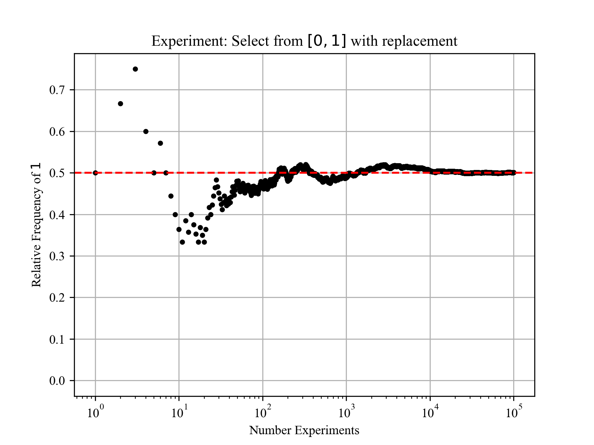

There is another way to answer this question. You can perform independent experiments of size $n=1, 2, ...$ and report the relative frequency for each independent experiment. The result is shown in the following plot.

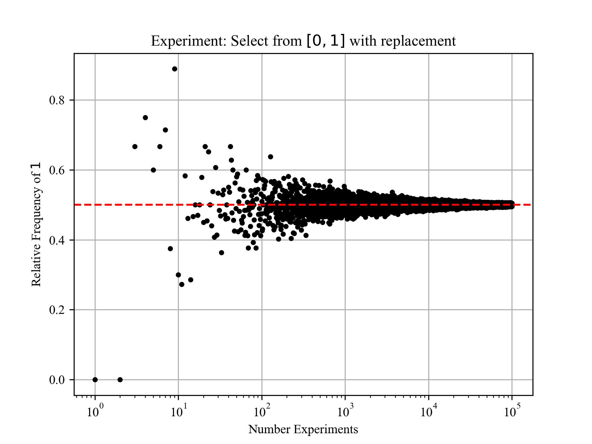

</details>

## Random Walk Simulation

A random walk is a process analogous to flipping a fair coin. An example in physics is a cylinder constrained to move in one dimension being struck by air particles (and the cylinder moves without friction). Each strike sends the cylinder a small step to the left or right. The probability of a step to the left is the same as that of a step to the right. See also [Chapter 1 of Kittel and Kroemer](http://www.fulviofrisone.com/attachments/article/413/Kittel%20-%20Thermodynamics.pdf) for a description in the context of statistical physics.

Suppose we want to know the probability that after three strikes, the cylinder is one step the right of its initial position using a simulation (we will cover an exact answer later).

We could do an experiment where we randomly select values of $-1$ or $1$ with equal probability using `random.choice([-1, 1])` three times (`np.random.choice()` can also be used for efficiency). A result could be `[1, 1, -1]`. The final position after these steps is `sum([1, 1, -1]) = 1`. To compute the probability that the final position is $1$, we can repeat this experiment many times and count the number of times the final position is $1$.

1. How many possible step configurations are possible? That is, what is the sample space of the experiment of taking three steps to right or left, with equal probability for each direction?
2. Write a program for a simulation that gives an estimate the probability that the cylinder is one step to the right of its initial position after three steps.

Save your code in a file named `HW1_2.py`.

<details>
<summary>Answer</summary>
1. $2^3=8$.

2. See [HW1_2.py](https://github.com/rweigel/stats/tree/main/solns), which has the following output.

   ```
   From 10000 experiments:
     P(sum = -3) = 0.1264
     P(sum = -2) = 0.0
     P(sum = -1) = 0.3649
     P(sum =  0) = 0.0
     P(sum =  1) = 0.3782
     P(sum =  2) = 0.0
     P(sum =  3) = 0.1305
   ```
</details>

## Sample Space

1. An experiment involves tossing a coin 3x. What is the sample space of this experiment?
2. How many of the outcomes in the sample space had two heads? 
3. Define event $A$ to be that the experiment yields two heads. Define event $B$ as the experiment yielding two tails. What is $A \cup B$ and $A \cap B$?

Save your answer in a file named `HW1_3.pdf`.

<details>
<summary>Answer</summary>

1. The sample space has 8 elements ($2^3$). This list can be found using a tree diagram as shown below.

    ```
            H       HHH
        H -
            T       HHT
    H -        
            H       HTH
        T -
            T       HTT

            H       THH
        H -
            T       THT
    T -        
            H       TTH
        T - 
            T       TTT

    ```
2. $3$ by inspection of the table above. Also, suppose that we have three unique coins $T$, $H_1$, and $H_2$. There are $3!$ unique permutations. If we drop the subscripts, then the number of unique permutations is divided by 2. So $3!/2=3$.

3. By inspection of the list from 1., $A \cup B = $ {$HHT, HTH, HTT, THH, THT, TTH$} and  $A \cap B = \emptyset$.

In the above, I assumed "experiement yields two heads" to mean "the experiment yielded exactly two heads" and not "the experiement yielded two or more heads".
</details>

## Law of Addition and Set Notation

Suppose 55\% of people exercise and 45\% drink alcohol. Also, 70\% do at least one of these.

What is the probability that a randomly selected person:
1. exercises and drinks alcohol?
2. does not do at least one of the two activities?

Use a Venn diagram (or any visual method) in the way that was used in class to demonstrate your answers.

Save your answer in a file named `HW1_4.pdf`.

<details>
<summary>Answer</summary>

Given: $P(E) = 0.55$, $P(A) = 0.45$, and $P(E\cup A) = 0.7$

1. $P(E \cap A) = P(E) + P(A) - P(E \cup A) = 0.3$
2. $P\big( (E \cup A)' \big) = 1 - P(E \cup A) = 1 - 0.7 = 0.3$
</details>

# HW 2

Due Thursday, September 10th at 11:59 pm.

## Bayes' Rule

2\% of the population has cancer. A screening test claims cancer in people with cancer 80\% of the time and it claims cancer in people without cancer 9.6\% of the time.

You take a test and it claims cancer.

1. What is actual probability that you have cancer?
2. Why is this answer different from the answer to Quiz 1?

<details><summary>Answer</summary>
1. $\simeq 0.145$

   $$P(C|T^+) = \frac{ P(T^+|C)P(C)}{P(C)P(T^+|C) + P(C')P(T^+|C')}$$

   $$P(C|T^+) = \frac{0.02\cdot 0.8}{0.02\cdot 0.8 + 0.98\cdot 0.096}\simeq 14.5{\%}$$

   See also a [solution using a visual method](https://docs.google.com/spreadsheets/d/1a3ty9V5bsDWKugk02zNPkO8LDG5FKQ-Mzs_Cxc-_S5o/edit?gid=1074592884#gid=1074592884)


2. In Quiz 1, the rate of false detection was 20\%. In this problem, the rate is lower, 9.6\%. The difference in the calculation is in bold below.

   Quiz 1 solution:

   $$\frac{0.02\cdot 0.8}{0.02\cdot 0.8 + 0.98\cdot \mathbf{0.2}}\simeq 7.5{\%}$$

   This problem:

   $$\frac{0.02\cdot 0.8}{0.02\cdot 0.8 + 0.98\cdot \mathbf{0.096}}\simeq 14.5{\%}$$

   To see this more clearly, re--write the denominator

   $$\frac{0.02\cdot 0.8}{0.02\cdot 0.8(1 + \frac{0.98}{0.8\cdot 0.2}\cdot P(T^+|C'))}$$
   
   This simplifies to
   
   $$\frac{1}{1 +6.1\cdot P(T^+|C')}$$
   
</details>

Save your answer as `HW2_1.pdf` and upload it to your GitHub account.

## Counting Problems

Find a problem in a textbook involving permutations and/or combinations (cite your source unless you made up the problem) and provide a solution. Be prepared to explain the problem and its solution in class.

Try to find a problem that is challenging and find a way to explain your solution in multiple ways (e.g., table, tree diagram, code, etc.).

If the problem is complex and difficult to explain, make up a similar but simpler problem first so that the full problem's solution is easier to understand.

Save your answer as `HW2_2.pdf` and upload it to GitHub. I'll randomly select students to explain their answer at the whiteboard during class.

## Expectation Values

The binomial probability mass function is 

$$P(X=x)={n \choose x}p^x(1-p)^{n-x}$$

(sometimes the simpler but equivalent notation $P(x)$ is used).

The expectation value of $h(X)$ is

$$E[h(X)] = \sum_{\text{all vals of }X} h(x) p(x)$$

1. By hand, compute $E[X]$ when $n=3$ and $p=1/2$. That is, compute $E[h(X)]$ when $h(X)=X$.

2. (590 only) Prove that $E[X]=np$.

   Hint: Rewrite so that you can use the fact that
   
   $$(p+q)^n = \sum_{x=0}^n{n\choose x} p^x q^{n-x} = 1$$
   
   because $p+q=1$.

<details><summary>Answer</summary>
1.

$$E[X] = \sum_{x=0}^3 x P(x) = \sum_{x=0}^3 x {n\choose x} p^{1/2}q^{1/2}$$

$$E[X] = 0\cdot \frac{3!}{0!3!}\left(\frac{1}{2}\right)^3 + 1\cdot\frac{3!}{1!2!}\left(\frac{1}{2}\right)^3 + 2\cdot\frac{3!}{2!1!}\left(\frac{1}{2}\right)^3 + 3\cdot\frac{3!}{3!0!}\left(\frac{1}{2}\right)^3$$

$$E[X] = 0 + 3\left(\frac{1}{2}\right)^3 + 2\cdot 3\left(\frac{1}{2}\right)^3 + 3\cdot 1\left(\frac{1}{2}\right)^3$$

$$E[X] = 0 + 3/8 + 6/8 + 3/8 = 12/8 = 1.5$$

2.

$$P(X=x)={n \choose x}p^x(1-p)^{n-x}$$

$$E[X] = \sum_{\text{all vals of }X} x {n \choose x}p^x(1-p)^{n-x} = \sum_{n=0}^n x {n \choose x}p^x(1-p)^{n-x}$$

Expanding the sum gives

$$E[X] = (1)\frac{n!}{1!(n-1)!}p^1q^{n-1} + (2)\frac{n!}{2!(n-2)!}p^2q^{n-2} + ... + (n)\frac{n!}{n!0!}p^nq^{0}$$

We are told that the answer is $np$, so factor it out.

$$E[X] = np\left[(1)\frac{(n-1)!}{1!(n-1)!}p^0q^{n-1} + (2)\frac{(n-1)!}{2!(n-2)!}p^1q^{n-2} + ... + (n)\frac{(n-1)!}{n!0!}p^{n-1}q^{0}\right]$$

Now simplify by combining the terms $(1), (2), ...$ with the first factorial in the denominators.

$$E[X] = np\left[\frac{(n-1)!}{1!(n-1)!}p^0q^{n-1} + \frac{(n-1)!}{1!(n-2)!}p^1q^{n-2} + ... + \frac{(n-1)!}{(n-1)!0!}p^{n-1}q^{0}\right]$$

Let $m=n-1$. Then

$$E[X] = np\left[\frac{m!}{1!m!}p^0q^{m} + \frac{m!}{1!(m-1)!}p^1q^{m-1} + ... + \frac{m!}{m!0!}p^mq^{0}\right]$$

The term in brackets is almost what we need. The only problem is the $1!$ term should be $0!$. However, $1!=0!$, so we have

$$E[X] = np\left[\frac{m!}{0!m!}p^0q^{m} + \frac{m!}{1!(m-1)!}p^2q^{m-1} + ... + \frac{m!}{m!0!}p^mq^{0}\right]$$

$$E[X] = np\sum_{i=0}^m{m \choose x}p^x(1-p)^{m-x}$$

Using the identiy given as a hint gives the answer.

$$E[X] = np(p+q)^m = np(1)^m=np$$
</details>

Save your answer as `HW2_3.pdf` and upload to GitHub.

## Binomial Distribution

In Devore 3.4, an experiment that conforms to the Bernoulli trials constraints is referred to as a "Binomial Experiment."

A Bernoulli trial has 

* two possible outcomes;
* the probability of "success" is $p$ and the probability of "failure" is $1-p$;
* these probabilities don't change

For $n$ trials, the probability of $x$ successes is given by the Binomial distribution:

$$P(x)={n \choose x}p^x(1-p)^{n-x}$$

1. Use a random number generator to simulate 10,000 Binomial experiments with $n=100$ and $p=0.4$ and plot $P(x)$. That is, execute 10,000 experiments in which the experiment is selecting 100 values from the list `[0, 1]` with the probability of selecting a $1$ being $p$. On the same axes, plot $P(x)$ expected from the equation above using the given $n$ and $p$. 

2. In the next class, I'll show that as $n\rightarrow \infty$, and for $x \approx np$,

   $$P(x)\rightarrow \frac{1}{\sqrt{2\pi n p q}} e^{-(x-np)^2/2npq}$$

    where $q \equiv 1-p$ (the symbol $\equiv$ means "is defined to be").

    Plot this $P(x)$ on the same axes as $P(x)$ in part 1.

Save your code as `HW2_4.py` and the plot as `HW2_4.png`.

4. Discussion questions for class (you do not need to turn anything in for this).
   * What is an interpretation of the meaning of the constraint $x \ll np$?
   * You are given a list of $10,000$ `0`s and `1`s and a claim that the values were generated by Bernoulli trials. How would you test this claim?

**Partial Answer**

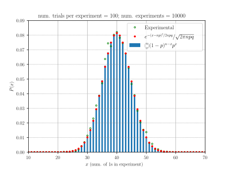

# HW 3

Due on Friday, September 18th at noon. (Extra time because I posted late.)

## Poisson Distribution

The Poisson distribution can be derived as a limit of the Binomial distribution; see Devore 3.6 and your class notes.

If

1. in a sufficiently short amount of time, $\Delta t$, only 0 or 1 event can occur (two or more simultaneous events are impossible); and
2. the probability of exactly one event occurring in $\Delta t$ is equal to $\lambda \Delta t$, where $\lambda$ is a constant.

the probability of $x$ events occurring in the time interval $t=n\Delta t$ is

$$P(x)=\frac{(\lambda t)^x e^{-\lambda t}}{x!}$$

for sufficiently large $n$. Said another way, if you measure events with a recording device, choose the sampling rate of the recording device to be small enough that two events never occur in the same $\Delta t$, and let the device record for a time of $t=n\Delta t$, the probability of recording $x$ events in a recording time of $t$ is given by the above formula. To estimate $\lambda$, one can use $p$ using $x/n$ and $\lambda = p/\Delta t$.

Use a random number generator to create a dataset that simulates the following result. Every hour, the number of x-ray flares is tabulated. It is found that over $1,000$ days, $900$ flares occurred so that the average probability of a flare in a given hour is $900/(1000\cdot 24)$.

On previous homework problems, many of you have used `math.choice()` or `np.random.choice()` to create create a value or values by drawing a `0` with a probability `p` and a `1` with probability `q`. There is an alternative that I recommend from now on: [np.random.binomial()](https://numpy.org/doc/2.1/reference/random/generated/numpy.random.binomial.html).

1. Plot

   a. $P_S(x)$, the probability of $x$ flare events occurring **per day** for the **S**imulated dataset,

   b. $P_P(x)$ expected from the equation above using the value of $\lambda$ computed based on the **P**oisson distribution equation above, and

   c. $P_B(x)$ expected from the **B**inomial distribution, from which the Poisson distribution was derived.

   Note that in class, we computed by hand $P_P(2)$ and $P_B(2)$, so use these values to check your plots for b. and c.

2. From your dataset, derive a new dataset, the time between flares, and plot a histogram of the time between flares.

Save your code as `HW3_1.py` and the plot as `HW3_1.png`. Spend time thinking about the label axes, title, legend, colors, and annotations. As discussed, you want to have enough detail on the plot so that a reader can start to make interpretations without having to read or hear a long description. 

Be prepared to justify any differences between the three cases in class.

**Answer**

[HW3_1.py](solns/HW3_1.py)

----

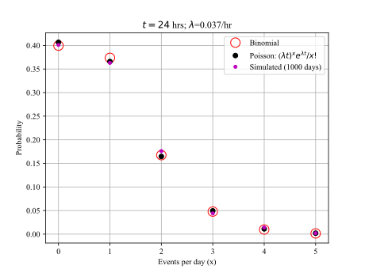

Same as above, but semilog-y

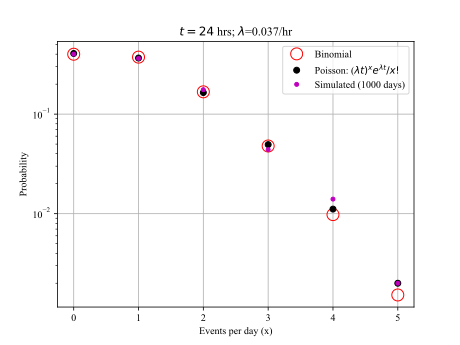

----

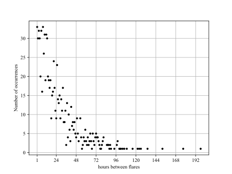

Same as above, but semilog-y

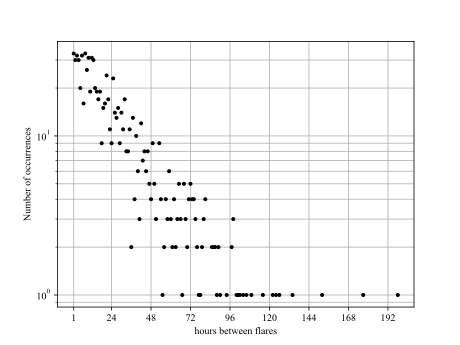

## Law of Large Numbers

The Law of Large Numbers tells us, roughly, that as $n\rightarrow \infty$ the sample average defined by

$$\overline{X}\equiv\frac{1}{n}\sum_{i=1}^n X_i$$

will be near the population average $\mu$ with a given probability. Given $n$ samples from a population, we don't expect $\overline{X}$ to exactly match $\mu$. The Law of Large Numbers allows us to make a statement about the difference $\overline{X}-\mu$. Specifically, the statement involves the probability that $|\overline{X}-\mu|$ is smaller that a certain value.

To answer the following questions, you do not need to understand the Law of Large Numbers. However, if you are interested, more formal definitions and proofs are given in [Orloff and Bloom, Reading 6b](https://ocw.mit.edu/courses/mathematics/18-05-introduction-to-probability-and-statistics-spring-2014/readings/MIT18_05S14_Reading6b.pdf), [DeGroot, Chapter 6](https://drive.google.com/file/d/1FtvQS1303P_GA4aM3ZbQIGPbThTXmfpq/view?usp=sharing★★★★★remove★★★★★), and [Rozanov, p 69](https://drive.google.com/file/d/1ROIF0mLquDcoMGJtj5Oz93On_ATCcfmc/view?usp=drive_link★★★★★remove★★★★★). Note that there the definition of the law of large numbers is not consistent in these references.

###

1. Draw $n=100$ values from a population of Gaussian-distributed numbers with mean $\mu=0$ and standard deviation $\sigma=1$.
2. Compute $\overline{X}$.
3. Repeat 1. and 2. $10,000$ times and plot a probability density function of $\overline{X}$.

Save your program as `HW3_2_1.py` and the associated plot as `HW3_2_1.png`. When I execute your program, I should see a histogram with _**the average of**_ $\overline{X}$ displayed in the title and it should write the file `HW2_3_1.png`.

**Answer**

[HW3_2_1.py](solns/HW3_2_1.py)

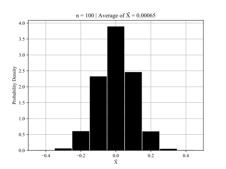

###

1. For $n=100$, what fraction of the $10,000$ $\overline{X}$s were in the range $[-0.01, 0.01]$?
2. How does the fraction depend on $n$? <sup>+</sup>
3. For $n=100$, what is the range $[-\epsilon,\epsilon]$ for which $99$% of the $10,000$ $\overline{X}$s fall in? 
4. How does $\epsilon$ depend on $n$ (for the 99% case of part 3.)? <sup>+</sup>
5. How does your answer change if the distribution changes (that is, if you draw values from a distribution other than Gaussian)?

<sup>+</sup> You may explain this using one or more of words, tables, and plots.

Save your program as `HW3_2_2.py`. Save your answers in a file named `HW3_2_2.pdf`, `HW3_2_2.txt`, or `HW3_2_2.md`. 

**590 students**: Be prepared to discuss in class at the whiteboard how this experiement is related to the Weak Law of Large Numbers and the Central Limit Theorem. You'll need to find resources that define and explain these.

**Answer**

[HW3_2_2.py](solns/HW3_2_2.py)

1\. 0.076

2\. As $n$ increases, fraction increases. This corresponds to the PDF in the previous plot getting sharper.

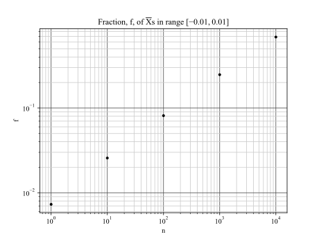

3\. $[-0.258, 0.258]$


4.

   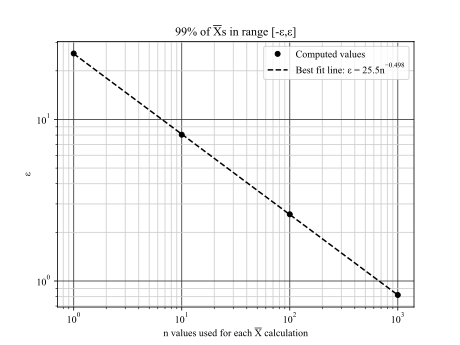

5\. Try running the code with it uncommented and notice that the histogram is still Gaussian--ish even though a uniform distribution was used for the $n$ $X$s.

## Sampling Distribution

A **statistic** is a quantity that is calculated from a sample of a population. An example is the sample mean, usually denoted as $\overline{X}$.

A **point estimate** is a statistic that is compute from a sample that is an estimate of a population parameter. If the population mean is $\mu$, then we use $\overline{X}$ as a point estimate of $\mu$.

When we draw a sample from a population and compute a point estimate such as $\overline{X}$, we won't get exactly $\mu$. Each sample will vary a bit. A **sampling distribution** characterizes the distribution of values (histogram or probability distribution) of $\overline{X}$ that we would get if we took many independent samples and computed many $\overline{X}$s.

We compute error bars based on the sampling distribution of point estimates.

For these problems, I recommend using

```
mu, sigma = 0, 0.1 # mean and standard deviation
sample = np.random.normal(mu, sigma, n)
```

Optionally, if you read through the documentation for [`np.random.normal()`](https://numpy.org/doc/2.1/reference/random/generated/numpy.random.normal.html), you should see that you can create a $(n, ne)$ matrix with columns that correspond to a sample and rows that correspond to the values within a sample. If this is used, you can avoid using a `for` loop.

### Sampling Distribution of $\overline{X}$

1. Draw $n=10$ values from a normal distribution with $\mu=0$ and $\sigma^2=1$ and compute $\overline{X}$. Repeat this 10,000 times and plot the probability density function of $\overline{X}$. On the plot title, show the average value of the 10,000 $\overline{X}$ values.

2. Of the 10,000 $\overline{X}$ values, what fraction was above $1/\sqrt{n}$? Add this fraction to the title of your previous plot.

3. (590 only) Think of a numerical experiment that you can perform to determine how the fraction computed in part 2. depends on $n$. Create a plot that demonstrates the result of your experiment.

4. (590 only) Repeat parts 1. and 2. using a uniform distribution in the range $[0,1]$ (use the `np.random.uniform()` function).

**Answer**

[HW3_3_1.py](solns/HW3_3_1.py)

1. & 2.

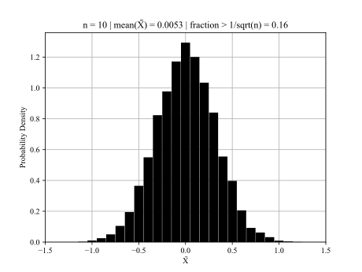

3.

This is expected (the value of $\sim 0.155$ and the independence on $n$). Why?

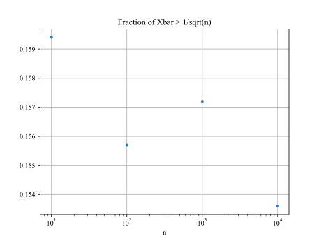

4.

Problem statement should have had range of `[-1, 1]`. If this is done, fraction above is $0.043$. Follow-up question is why this differs from uniform case. Answer is that normal and uniform population distributions have same sampling distribution -- a normal with mean zero and standard deviation of $\sigma/\sqrt{n}$. However, the variance of the uniform distribution is $(b-a)^2/12=0.25$, so to get the same fraction, need to ask what fraction is above $\sqrt{0.25}/\sqrt{n}$. With this threshold, one gets approximately the same value for the threshold for the uniform and normal population cases.

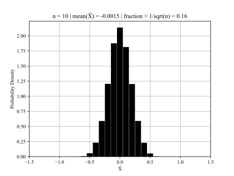

### Sampling Distribution of $S_b^2$

You may have guessed that if a population of $N$ values has a variance of $\sigma^2$, where

$$\sigma^2=\frac{1}{N}\sum_{i=1}^N(x_i-\mu)^2$$

that a reasonable point estimate of $\sigma^2$ for a sample of $n$ values from the population is

$$S_b^2=\frac{1}{n}\sum_{i=1}^n(x_i-\overline{X})^2$$

To determine if this is the case, sample $n=10$ values from a normal distribution with $\mu=0$ and $\sigma=1$, computing $S_{b}^2$, and repeating $N_e=10,000$ times. Plot the histogram of the $10,000$ $S_{b}^2$ values, and, in the title, display the average and variance of the $10,000$ $S_{b}^2$ values. Save your code as `HW3_3_2.py` and plot as `HW3_3_2.png`.
    
%Draw $n=10$ values from a normal distribution with $\mu=0$ and $\sigma^2=1$ and compute  $S_{b}^2$. Repeat this 10,000 times and plot the probability density function of $S_{b}^2$.
%On the plot title, show the average value of the 10,000 $S_{b}^2$ values (it should be slightly less than $\sigma^2$).

The motivation for the subscript $b$ in $S_b^2$ is that $S_b^2$ is a **biased estimator** or $\sigma^2$. This concept will be discussed in the next class.

**Answer**

As discussed in class, $S_b^2$ is a biased esimator of $\sigma^2$. Replacing the $n$ with $n-1$ results in the mean of the numerically generated sampling distribution being closer to $1.0$. (The ratio of $S^2_b/S^2$ is $(n-1)/n$, which is $0.9$ for $n=10$.)

To understand why $S_b^2$ is biased low, consider $n=1$. In this case $S_b^2=0$ always, independent of $\sigma^2$. As $n$ approaches $\infty$, you expect the bias to approach zero. So it may make sense that the bias is between 0 and 1 for all $n$. Another explanation is that equation for $S_b^2$ contains $\overline{X}$. As a result, the terms in the sum will be closer to $\overline{X}$ on average than if the equation has $\mu$ in place of $\overline{X}$. It is also sometimes stated that to compute $S^2_b$, you are using one less independent value (the "degrees of freedom" is one less) because computing $\overline{X}$ effectively reduces the number of independent values in the sample by 1. 

%$$S_b^2=\frac{1}{n}\sum_{i=1}^n(x_i-\overline{X})^2 = \frac{1}{3}\left(x_1 - \frac{x_1+x_2+x_3}{3}\right)^2 + ... = \frac{1}{3}\left(\frac{2}{3}x_1 - \frac{x_2+x_3}{3}\right)^2 + ... = $$

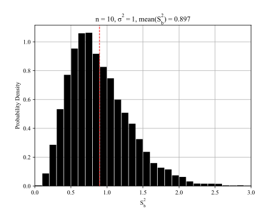

# HW 4

## Confidence Interval for $\mu$

A random variable $T$ that is $t$ distributed with $n-1$ degrees of freedom has

$$P\left(-t_{\alpha/2,n-1} < T < t_{\alpha/2,n-1}\right) = 1-\alpha$$

It can be shown that the "standardized variable"

$$T=\frac{\overline{X}-\mu}{S/\sqrt{n}}$$

is $t$--distributed with $n-1$ degrees of freedom.

Let $\overline{x}$ and $s$ be the sample mean and the sample deviation computed from the results of a random sample from a normal population with a mean $\mu$ and an unknown variance. Then a $100(1-\alpha)$% confidence interval for the mean $\mu$ is

$$\left(\overline{x}-t_{\alpha/2, n-1}\frac{s}{\sqrt{n}}, \quad \overline{x}+t_{\alpha/2, n-1}\frac{s}{\sqrt{n}}\right)$$

Suppose a sample of $n=20$ values had $\overline{x}=10$ and $s=1.03$.

1. What is the 99% CI?

   Note that you may use the table I handed out, table A5 of Devore, or the `ppf` function to find the $t_{\alpha/2, n-1}$. An example usage on a different problem is:

   ```
   # Example 7.11 requires t_{alpha/2, n-1} with alpha = 0.05 and n = 30
   # Find t value such that area to right is 1-0.025 (see Figure 7.8):
   scipy.stats.t.ppf(1-0.025, df=29) 
   # 2.0452296421327034
   ```

2. Compute the confidence interval using the formula for the case where we know the population standard deviation $\sigma$

   $$\left(\overline{x}-z_{\alpha/2}\frac{\sigma}{\sqrt{n}}, \quad \overline{x}+z_{\alpha/2}\frac{\sigma}{\sqrt{n}}\right)$$

   by assuming $\sigma=s$. You can use `scipy.stats.norm.ppf` to compute $z_{\alpha/2}$.

   Be prepared to answer in class why one confidence interval is larger than the other.

3. Write a program that repeats parts 1. and 2. assuming the same values for $\overline{x}$ and $s$ but $n=5, 10, 15, ..., 100$ and prints

   ```
   n = 5    length1   length2
   n = 10   length1   length2
   ...
   n = 100  length1   length2
   ```

   where `length1` is the length of the confidence interval using the formula in part 1. and `length2` is the confidence interval using the formula in part 2.

Save your answer as `HW4_1.py`. When executed, it should print
```
Answer 1: ...
Answer 2: ...
Answer 3:
   n = 5    length1   length2
   n = 10   length1   length2
   ...
   n = 100  length1   length2
```

Also, copy the printed output and put it in a comment in `HW4_1.py`.

**Answer**

[HW4_1.py](solns/HW4_1.py)

```
Answer 1: [9.34, 10.66]
Answer 2: [9.41, 10.59]
Answer 3:
   n=  5:  4.24,  2.37
   n= 10:  2.12,  1.68
   n= 15:  1.58,  1.37
   n= 20:  1.32,  1.19
   n= 25:  1.15,  1.06
   n= 30:  1.04,  0.97
   n= 35:  0.95,  0.90
   n= 40:  0.88,  0.84
   n= 45:  0.83,  0.79
   n= 50:  0.78,  0.75
   n= 55:  0.74,  0.72
   n= 60:  0.71,  0.69
   n= 65:  0.68,  0.66
   n= 70:  0.65,  0.63
   n= 75:  0.63,  0.61
   n= 80:  0.61,  0.59
   n= 85:  0.59,  0.58
   n= 90:  0.57,  0.56
   n= 95:  0.56,  0.54
   n=100:  0.54,  0.53
```

## Confidence Interval for $\sigma^2$

In Devore 7.4, a confidence interval for the variance of a normal population is given.

1. Use a Python program and `scipy.stats.chi2.ppf` to solve Example 7.15 of Devore.

   Save your code as `HW4_2_1.py`. When executed, it should print the confidence interval and copy what is printed into a comment in  `HW4_2_1.py`.

   **Answer**

   [HW4_2_1.py](solns/HW4_2_1.py)

   ```
   Sample variance: 137324.26
   Chi2 lower: 6.91, Chi2 upper: 28.85
   95% CI for the variance: [76171.31, 318079.76]
   ```

2. (590 only) In HW 3.3.2, you numerically generated an approximation of the sampling distribution of $S_b^2$ (represented as a histogram). In section 7.4 of Devore, the exact sampling distribution of $(n-1)S^2/\sigma^2$ is claimed to be $\chi^2_{n-1}$ when $n$ values are drawn from a normal distribution with standard deviation $\sigma$.

   Modify your code for HW 3.3.2 to numerically generate an approximation of the sampling distribution of $(n-1)S^2/\sigma^2$ using $n=10$ and $\sigma=1$. 

   Create a plot that compares your approximation of the sampling distribution of $(n-1)S^2/\sigma^2$, represented as a probability density, with that predicted by the $\chi^2$ distribution with $9$ degrees of freedom.

  Use your $(n-1)S^2/\sigma^2$ probability density to get an estimation for the values found using `scipy.stats.chi2.ppf` in part 1.

   Save your code as `HW4_2_2.py`. When executed, it should save the plot as `HW4_2_2.png` and print the CI estimated using your $(n-1)S^2/\sigma^2$ probability density. Make sure to upload the png file to your repository and copy what is printed into a comment in your code.

   **Answer**

   [HW4_2_2.py](solns/HW4_2_2.py)

   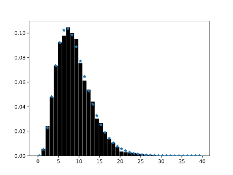

## It's a Trap

Devise a numerical experiment that demonstrates that a confidence interval for the mean, $\mu$ of a population "traps" $\mu$ with a probability $100(1-\alpha)$\%.

Please ask questions via Discord or by email if you don't know where to start.

Save your code as `HW4_3.py` and any associated plots as `HW4_3a.png, HW4_3b.png, ...`. Be prepared to explain your approach in class.

   **Answer**

   [HW4_3.py](solns/HW4_3.py)

   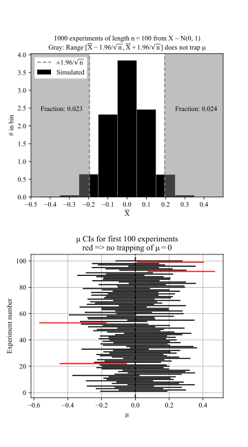

# HW 5

## Regression

<details><summary>Code from Class</summary>
```python
import numpy as np

def experiment(x):
  beta0 = 1
  beta1 = 1
  sigma = 0.1
  eps = np.random.normal(0, sigma, len(x))
  y = beta0 + beta1*x + eps
  return y

def compute(x, y):
  n = len(x)
  beta1 = (y[n-1] - y[0])/(x[n-1] - x[0])
  beta0 = y[-1] - beta1*x[-1]
  return beta0, beta1

def compute_ols(x, y):
  beta1 = ...
  beta0 = np.mean(y) - beta1*np.mean(x)

# from scipy.stats import linregress
# res = linregress(x, y)
x = np.arange(0, 6)
print(x)
y = experiment(x)
print(y)

beta0, beta1 = compute(x, y)
print(beta0, beta1)

ne = 10000
beta0s = np.full(ne, np.nan)
beta1s = np.full(ne, np.nan)
for i in range(ne):
  y = experiment(x)
  beta0s[i], beta1s[i] = compute(x,y)
```
</details>

When fitting a straight line to data using the equation $y = b_1x + b_0$, we typically make assumptions about the process that generated the data. First, we assume that each of the sampled $y_i$ ($i=1,...,n$) values was generated by drawing a value from a Gaussian distribution with $\mu=0$ and standard deviation $\sigma$ and then adding to it $\beta_1 x_i + \beta_0$, where $x_i$ are values that are known with zero uncertainty. The values of $\beta_0$ and $\beta_1$ are unknown quantities that we seek to estimate.

To simulate the process of generating the $y_i$ values described above, choose a value for $x_i$. Next, draw a value from a Gaussian distribution with a mean of zero and standard deviation of $\sigma$, the value of which is represented by the variable $\epsilon_i$. Then solve for $y_i$ using

$$y_i = \beta_1 x_i + \beta_0 + \epsilon_i.$$

Repeating this process $n$ times will yield $n$ values of $y$ and $x$. When we do linear regression on a set of measurements, we assume that the system we took measurements from works in a way equivalent to the above process -- we give the system an input of an $x_i$ value and it returns an output $y_i$ based on this process.

1. Create a sample of $n=20$ $(x,y)$ pairs using $\beta_0=1$, $\beta_1=1$, and $\sigma=0.2$. For values of $x$, use $0, 1/N, 2/N, ..., (N-1)/N$. Create a scatter plot of these $n$ $(x,y)$ values.

2. Use the equations derived in class to compute $b_0$ and $b_1$ using the 20 values drawn in part 1. Include these values on the plot for part 1.

3. Find a Python library that computes $b_0$ and $b_1$ for you. When your code is executed, it should print out the values of $b_0$ and $b_1$ computed with the library. Include these values on the plot for part 1.

4. Compute the 95% confidence interval for $b_1$ (see Chapter 12 of Devore).  Include the confidence interval on the plot for part 1.

   Note that some libraries will compute confidence intervals, but I want you to look up the equations because it is not always the case that a library will compute confidence intervals, and if it does, you should compute it on your own and compare to the library result to ensure (1) the library is producing the correct result and (2) your understanding of what the library is ccomputing is correct. Most commonly used libraries have been tested by many users, so their calculation is usually correct, and thus doing the check for (1) may seem excessive. However, quite often we mis--interpret the documentation for the library, which will be revealed by the check for (2).

Save your code as `HW5_1.py` and plot as `HW5_1.png`.

5. (590 only) Suppose that you want to run a few tests to determine if the equation for the 95% confidence interval in Chapter 12 of Devore is correct. Create as simulation that uses repetition and trapping to test the confidence interval equation. Save your code as `HW5_1_test.py` and any plots as `HW5_1_test.png`. In code comments, state what you are testing.

## DFT Part I

The Fourier series model for $y$ having an odd number $N$ time steps is

$$y_t = \alpha_0 + \sum_{i=1}^{q}\left[\alpha_i \mbox{cos}(2\pi f_i t) + \beta_i \mbox{sin}(2\pi f_i t)\right] + \epsilon_t\thinspace,$$

where $\ds f_i \equiv \frac{i}{N}$. For $N$ even,

$$y_t = \alpha_0 + \sum_{i=1}^{q}\alpha_i \mbox{cos}(2\pi f_i t) + \sum_{i=1}^{q-1}\beta_i \mbox{sin}(2\pi f_i t) + \epsilon_t\thinspace,$$

The least-squares estimates for the $\alpha$ and $\beta$ values (the estimates for $\alpha_i$ are $a_i$ and the estimates of $\beta_i$ are $b_i$):

$\ds a_0 = \frac{1}{N}\sum_{t=0}^{N-1} y_t \equiv \overline{y}$ 
$\quad$
$\ds a_i = \frac{2}{N}\sum_{t=0}^{N-1}y_t\mbox{cos}(2\pi f_i t)$
$\quad$
$\ds b_i = \frac{2}{N}\sum_{t=0}^{N-1}y_t\mbox{sin}(2\pi f_i t)$

with $i=1,2,...,q$ and 

$
q = 
\begin{cases}
  N/2 &       \text{if } N \text{ even} \\
  (N - 1)/2 & \text{if } N \text{ odd}
\end{cases}
$

The values of $a$ and $b$ are also called the discrete Fourier transform (DFT) coefficients.

There are a total of $N$ unknown parameters in the model equation.
* If $N$ is odd, for example $N=5$, then $q=2$ and the unknowns are $a_0$, $a_1$, $a_2$, $b_1$, $b_2$.
* If $N$ is even, for example $N=4$, then $q=2$ and the five unknowns based on the above are $a_0$, $a_1$, $a_2$, $b_1$, $b_2$. However, $b_q=0$, so the number of unknowns is actually four (and the model equation is modified to have $\beta_q=0$).
There are a total of $N$ unknown parameters in the model equation. If $N$ is even, $b_q = 0$, and so the number of free parameters in the model equation is still $N$; also, the last $a$ term simplifies: $a_q = \frac{1}{N}\sum_{t=1}^{N} y_t(-1)^t$.

(The equations for the parameter estimates $a_i$ and $b_i$ are found by multiplying the Fourier series model equation by $\mbox{cos}(2\pi f_i t)$ and $\mbox{sin}(2\pi f_i t)$ and then summing both sides over $t=1$ to $N$. In the E&M book by Griffiths, he calls this "Fourier's trick".)

1. This part is unrelated to statistics, but I find myself doing this when I am trying to figure out what someone did to compute a plot and understand various other aspects of DFT calculations. The need for this is due to the definition ambiguity discussed above, indexing (MATLAB uses 1--based indexing, Python 0--based), and the fact that $q$ depends on if $N$ is even or odd.

   Consider the signal $y=[0, 1, 0, -1]$.
   
   Compute all $a$ and $b$ values using the above formulas.

2. Write a function named `dft` that takes an input of `y` in the form of a NumPy array and returns outputs of NumPy arrays `a` and `b` and the scalar `a0`. As a test case, your code should produce the results shown below. 

   ```python
   a0, a, b = dft(np.array([0, -1, 0, 1])
   print(a0) # 0.0
   print(a)  # [0.0  0.0]
   print(b)  # [0.0 -1.0]
   ```

3. (590 only) `numpy.fft` computes the DFT of $y_t$ using a formula of the form

   $$Y_k = \sum_{t=0}^{N-1} y_t e^{-j2\pi t k/N}$$

   with $k=0,...,N-1$. The output of `numpy.fft` is an array of complex numbers, e.g.,

   ```
   import numpy as np
   y = np.array([0, 1, 0, -1])
   Y = np.fft.fft(y)
   print(Y)
   # [0. + 0.j, 0. -2.j, 0. + 0.j, 0. + 2.j]
   ```

   Modify your function `dft` so that it takes a keyword argument of `fft` such that when set to `True`, it uses `np.fft.fft()` to compute `a0`, `a`, and `b` instead of your code for part 2.

Save your answers in a file named `HW5_2.py`.

## Project Part I

Perform exploratory data analysis on your project data or one of the datasets listed below. The objective is find ways of presenting the data that "tells the story" of its key features. What you choose to plot will depend on the data and your creativity.

Save the code and plots in a subdirectory named `project` in your repository. Save your code as `project_I.py` and plots as `project_I{a,b,...}.png`.

In class on October 22nd,

1. give a 2--minute description about the project data (where from, what values are in it, what it is used for, what research has been done on it); and
2. present at least three plots in class. If your data are time series, the first plot should be a time series of all of the data.

Do not create a PowerPoint presentation. For part 1., use the whiteboard if needed. For part 2., I will show the plots from your repository on the screen, and then you will explain them.

### Solar Flare Data

If you are interested in solar flares, you may start with the [`flares` directory](https://github.com/rweigel/stats/tree/main/project) and extend `project_I.py`.

### Ground Magnetometer Data

If you are interested in solar flares, you may start with the [`ground_mag` directory](https://github.com/rweigel/stats/tree/main/project) and extend `project_I.py`.

# Quiz 1

Study the cab example in the [Bayes' rule section of the notes](notes.html).

At the start of the Sept. 3rd class, I will ask you to solve a similar problem without notes. This will be the first quiz. This quiz will not be graded. If you attend class, you'll get full credit.

Problem given:

* 2\% of the population has cancer
* A screening test for cancer is correct 80\% of the time.
* Your screening test claimed cancer.

What is the probability that you actually have cancer?

<details>
<summary>Answer</summary>

$$\frac{16}{196+16} = \frac{0.02\cdot 0.8}{0.02\cdot 0.8 + 0.98\cdot 0.2}\simeq 7.5{\%}$$

where the first fraction is determined using Method II in the cab problem and the second using Method III.
</details>

# Quiz 2

**Description**

The quiz on Sept 10th will be on of the problems on counting that I covered in class (recall that there were three types: product rule, permutations, and combinations). The quiz will is closed book, closed notes, and closed computer and will be graded.

**Quiz** (5 minutes)

26 cards labeled A, B, ..., Z.

1. If order hatters, how many draws of 3 cards are possible? (That is, ABC and BAC are different draws.)
2. If order does not matter, how many draws of 3 cards are possible? (That is, ABC and BAC are considered to be the same draw.)

   <details><summary>Answer</summary>
   1. $26\cdot 25\cdot 24$
   2. $26\cdot 25\cdot 24/3!$
   </details>

# Quiz 3

**Description**

The quiz on September 17th will involve sample code that uses `np.random.normal()` and other basic functions that have been used on homework problems to do a calculation. You will be expected to explain what the program is doing. The objective of this quiz is to ensure that you understand and can explain code that has been used in your solutions and my solutions.

Example Problems

1. Given

    ```python
    import numpy as np
    sample = np.random.normal(0, 1, 10)
    print(np.mean(sample))
```

    1. How many elements are in `sample`?
    2. Modify this program so that you repeat the calculation of `sample` 10,000 times and store the mean of each sample in an `list` or `np.array`.


2. What is printed when the following is executed?

    ```python
    import numpy as np
    arr = np.array([[1, 1, 1], [2, 2, 2]])
    print(np.mean(arr, axis=0))
    print(np.mean(arr, axis=1))
    ```

3. Given

    ```python
    import numpy as np
    xbars = []
    nbig = 0
    for i in range(0, 1000):
      sample = np.random.normal(0, 1, 10)
      xbar = np.mean(sample)
      xbars.append(xbar)
      if xbar > 0.5:
        nbig = nbig + 1
    print(nbig)
```

    1. Modify this program so that it prints the number of times `|xbar| > 0.1`.
    2. Given the list `xbars`, write a single command that prints the number of elements that are above `0.5`. That is, suppose the `if` statement was not used. What would you write in place of `print(nbig)` to get the same printed value.

**Quiz**

(15 minutes)

1. Given

    ```python
    import numpy as np
    sample = np.random.normal(0, 1, 10)
    print(np.mean(sample))
```

    1. How many elements are in `sample`?
    2. If the value `10` is replaced with `100000`, will the printed value be larger, smaller, or equal?
    3. (590 only) modify the given program so that `sample` has `size=(10,30)` and it prints the average of the columns.


2. What is printed when the following is executed?

    ```python
    import numpy as np
    arr = np.array([[1, 1, 1], [2, 2, 2]])
    print(np.mean(arr, axis=0))
    print(np.mean(arr, axis=1))
    ```

3. Given

    ```python
    import numpy as np
    xbars = []
    nbig = 0
    for i in range(0, 1000):
      sample = np.random.normal(0, 1, 10)
      xbar = np.mean(sample)
      xbars.append(xbar)
      if xbar > 0.5:
        nbig = nbig + 1
    print(nbig)
```

    1. Modify this program so that it prints the number of times `|xbar| > 0.1`.
    2. (590 only) Given the list `xbars`, write a single command that prints the number of elements that are above `0.5`. That is, suppose the `if` statement was not used. What would you write in place of `print(nbig)` to get the same printed value?

\newpage

# Quiz 4

**Description**

This ungraded quiz that will contain problems that are nearly identical to examples 7.3 and 7.11 of Devore. You may use handwritten notes for this quiz, and I will provide the results of any required numerical calculations and any needed tables (such as the one needed for example 7.11).

For each problem, I will give students a few minutes to think of an answer without referring to notes or looking anything up.

Then we will reach a consensus as a group.

**Quiz**

Instead of a short quiz, I decided to give an in-class activity on the topics covered in the last lecture and in the reading associated with the quiz. See [Activity 1](#activity-1).

# Quiz 5

## Description

This is a _graded_ quiz.

1. A problem similar to example 8.2 of Devore. The table referenced in this problem will be provided.

2. (590 only) A question similar to: Instead of reporting the result

   * $H_0$: $\mu=2$ and $H_a$: $\mu \ne 2$; $H_0$ is rejected with a significance level of $0.05$
 
   some researchers report

   * "$\mu \ne 2$ with $P=0.0047$"

   Are these two statements equivalent? If not, modify one of them to make them equivalent. $P$ values are discussed in 8.4 of Devore.

## Quiz

15 minutes

**Hypothesis Test**

The drying time of paint has historically been $75$ minutes with a standard deviation of $9$ minutes.

A new additive was introduced that is claimed to decrease the drying time.

$n=25$ tests were done on the new paint, and the average drying time was $70.0$ minutes. Assume the samples were drawn from normally distributed population with a standard deviation of $9$.

A hypothesis test of

$H_0$: $\mu=75$ with a rejection region of $<70.8$

1. Should $H_0$ be rejected?

2. What is the probability of a Type I error for this hypothesis test?

_Answer_

1. Yes. 70 is in the rejection region of $<70.8$.
2. $P(\text{Type I})=0.01$: $Z=(70.8-75)/\sqrt{9/25}=-2.33$. From a table of the standard normal, the area to the left of $-2.33$ is $0.01$.

**$P$ values and Hypothesis Tests**

(590 only)

If a hypothesis test of:

* $H_0$: $\mu=2$
* $H_a$: $\mu \ne 2$

was performed and "$H_0$ was rejected with a significance level of $0.05$", some researchers may report only

> $\mu \ne 2$ with $P=0.0047$

Are these two statements equivalent?

If not, modify one of them to make them equivalent.

_Answer_

These are not equivalent. Replace $0.05$ with $0.0047$ or vice-versa. Ideally a researcher would state $H_0$ and $H_0$, the significance level of rejection, and then state "reject with $P=...$". However, often only one of the statements is given. The first statement does not tell us know how far into the rejection region the observed statistic is. The second statement does not let us know what the rejection confidence level was decided upon before the experiment was performed.

# Quiz 6

_This is a graded quiz_

You will be asked to derive the equations for $b_o$ and $b_1$ that minimize sum-squared error

$$\text{SSE}(b_o,b_1)=\sum_{i=1}^n\large(y_i-(b_o+b_1x_i)\large)^2$$

# Activity 1

## Point Estimate Definition

Define "point estimate".

## Sampling Distribution

Give an example of a sampling distribution.

## Sampling Distribution Bias

The population mean of the random variable with a set of possible values $D$ is defined as

$$\mu = \sum_{x\in D} xp(x).$$

where $p(x)$ is the probability of the value $x$ and $x\in D$ means "for all $x$ in $D$".

A point estimate of $\mu$ based on a random sample of $n$ values from this population is

$$\overline{X} = \frac{1}{n}\sum_{i=1}^n x_i$$

The expectation operator is defined as

$$E[h(X)] = \sum_D h(x) p(x)$$

where $D$ is the set of all possible values of $X$.

To show that $\overline{X}$ is unbiased, we use

$$E[\overline{X}] = E\left[\frac{1}{n}\sum_{i=1}^n x_i\right] = \frac{1}{n}E\left[x_1 + ... + x_n\right]$$

Justify this step. Next, we use

$$\frac{1}{n}\big( E[x_1] + ... + E[x_n] \big)= \frac{1}{n}\big(nE[X]\big) =\frac{1}{n}(n\mu)=\mu$$

1. This step used the fact that $E[x_1]=E[x_2]=...=E[X]$. Justify this.
2. In a previous homework, you approximated the expectation value of $\overline{X}$. What problem was this?

## Sampling Distribution Variance

1. How does the variance of the sampling distribution of $S^2$, the point estimate of $\sigma^2$, depend on $n$?

2. Given two point estimates that have no bias, should the one with a lower sampling distribution variance be used?

## Point Estimate Choice

Recall that $\overline{X}_e = (\text{max}+\text{min})/2$. Propose a numerical experiment that compares the sampling distribution of $\overline{X}_e$ with that of $\overline{X}$.

On p. 249 of Devore, it is noted that the best estimator for $\mu$ depends crucially on which distribution is being sampled from and that "If the underlying distribution is uniform, the best estimator is $\overline{X}_e$; this estimator is greatly influenced by outlying observations, but the lack of tails makes such observations impossible."

## Interval Estimate

1. Define an interval estimate.
2. How is an interval estimate related to a sampling distribution?
3. What are some types of interval estimates?

## Deriving a Confidence Interval

If $Z\sim\mathcal{N}(0,1)$ ($Z$ is a random variable that is normally distributed with a mean of zero and variance of 1), then

$P(-1.96 < Z < 1.96) = 0.95$

Where do the numbers $1.96$ and $0.95$ come from?

Devore computes a confidence interval for $\overline{X}$ by starting with

$$P\left(-1.96 < \frac{\overline{X}-\mu}{\sigma/\sqrt{n}} < 1.96\right) = 0.95$$

Why was this form used for $Z$?

## Computing a Confidence Interval

###

A $95$% confidence interval for the mean $\mu$ of a normal population when the value of $\sigma$ is known is given by

$$\left(\overline{x}-1.96\frac{\sigma}{\sqrt{n}}, \quad \overline{x}+1.96\frac{\sigma}{\sqrt{n}}\right)$$

How is this equation related to

$$P\left(-1.96 < \frac{\overline{X}-\mu}{\sigma/\sqrt{n}} < 1.96\right) = 0.95?$$

###

More generally, a $100(1-\alpha)$% confidence interval for the mean $\mu$ of a normal population when the value of $\sigma$ is known is given by

$$\left(\overline{x}-z_{\alpha/2}\frac{\sigma}{\sqrt{n}}, \quad \overline{x}+z_{\alpha/2}\frac{\sigma}{\sqrt{n}}\right)$$

(Devore Equation 7.5)

Suppose a sample of $100$ values had $\overline{x}=10.1$. We happen to know that the values were drawn from a population with $\sigma=1$.

What is a

* 95% CI?
* 99% CI?

Why is the statement "this is a 95\% CI for $\overline{x}$" wrong?

[Tables](https://www.craftonhills.edu/current-students/tutoring-center/mathematics-tutoring/distribution_tables_normal_studentt_chisquared.pdf). See also appendix of Devore.

## Interpreting a Confidence Interval

What is the correct interpretation of a confidence interval?

What is a common incorrect interpretation of a confidence interval?

## Other CIs

A random variable $T$ that is $t$ distributed with $n-1$ degrees of freedom has

$$P\left(-t_{\alpha/2,n-1} < T < t_{\alpha/2,n-1}\right) = 1-\alpha$$

It can be shown that the "standardized variable"

$$T=\frac{\overline{X}-\mu}{S/\sqrt{n}}$$

is $t$ distributed with $n-1$ degrees of freedom.

Devore Equation 7.15, p. 288 gives

Let $\overline{x}$ and $s$ be the sample mean and the sample deviation computed from the results of a random sample from a normal population with a mean $\mu$. Then a $100(1-\alpha)$% confidence interval for the mean $\mu$ is

$$\left(\overline{x}-t_{\alpha/2, n-1}\frac{s}{\sqrt{n}}, \quad \overline{x}+t_{\alpha/2, n-1}\frac{s}{\sqrt{n}}\right)$$

Suppose a sample of $100$ values had $\overline{x}=10$ and $S=1.03$. We happen to know that the values were drawn from a population with $\sigma=1$.

What is a

* 95% CI?
* 99% CI?

[Tables](https://www.craftonhills.edu/current-students/tutoring-center/mathematics-tutoring/distribution_tables_normal_studentt_chisquared.pdf). See also appendix of Devore.

## Experiments

The CI calculations are based on a single sample from a population, and their interpretation requires imagining a large number of experiments.

Propose a numerical experiment to explore the CI calculations.

## Bootstrapping a Confidence Interval Preliminaries

We don't always know the sampling distribution of a given statistic (a quantity computed from a sample such as $\overline{X}$ or $S$).

On a previous homework, you simulated the sampling distributions of $\overline{X}$ and $\overline{S_b^2}$ by taking samples from a known population distribution $10,000$ times.

Often, we have only one sample of size $n$ and don't have enough information about the population distribution to determine the sampling distribution analytically or numerically.

Idea: Create $10,000$ "bootstrap" experiments by sampling from the $n$ values with replacement and compute the statistic each time. Then the PDF of the statistic approximates the sampling distribution.

Suppose you are given the following code.

```python

n = 50
x_sample = np.random.normal(10, np.sqrt(10), n)
x_bar = np.mean(x_sample)
# Draw n values from x_sample with replacement
x_sample_b = np.random.choice(x_sample, size=n, replace=True)
x_bar_b = np.mean(x_sample_b)
```

1. How would you verify that `x_sample_b` is a draw of $n$ values from `x_sample` with replacement? (What is a "sanity" check?)

2. How would you modify this program to create 10,000 `x_bar_b` values?

\newpage

## Prelude to Hypothesis Testing

Figure 1. Visualization related to a confidence interval. The black curve is the sampling distribution of $\overline{x}$ assuming that samples were drawn from $\mathcal{N}(\mu, \sigma^2)$. $\overline{x}_{\text{sample}}$ actual value found from a sample of $n$ values.

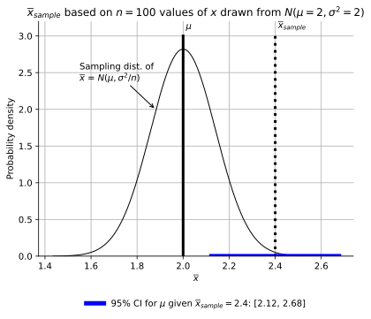

Figure 2. If instead of quoting a confidence interval, we want to make a claim about the probability that $\overline{x}_\text{sample}$ had the observed value assuming the sampling distribution is correct. We reject the claim about the sampling distribution if the observed value is in the red region.

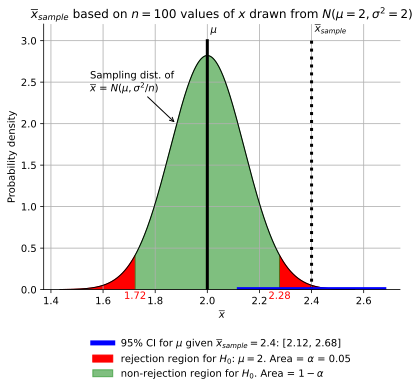

Questions:

1. What is the statistical interpretation of "rejection" (in the same spirit as the "trapping" explanation).
2. Could we determine if the claim can be rejected if the CI does not overlap $\mu=2$?
3. How is the probability that we mistakenly rejected the claim depend on $\alpha$?

\newpage

# Midterm

## Study Guide

The 2--hour closed--book and closed--notes midterm will have problems similar in style and topic to the sample midterm questions.

You should have memorized any equation that you need to know to solve one of the midterm questions. Tables for the $z$ and $t$ distributions will be provided.

Grading: A grade of 85% on a given problem means I have found evidence that you understood the concept associated with the question and if I said "this calculation does not look correct", you would quickly identify the issue. Scores higher than 85% correspond to fewer such "minor issues". (There is an exception -- when a "minor issue" leads to a nonsensical final answer and the fact that the final answer does not make sense is not noted, I will conclude that you don't understand the concept.)

**Sample Midterm Questions**

All quiz problems, examples worked through in class, and [Activity 1 questions](hw.html#activity-1) are sample questions. In addition, the following questions test your understanding of the homework problems.

###

Provide a derivation (visual or mathematical) of $P(B|A)=P(A|B)P(B)/P(A)$

> Some students gave an example of the use of this formula but did not provide either a mathematical or visual derivation. I covered several derivations in class, and they also appear in many textbooks.

###

(590 only) One bag contains only white balls, while another bag contains 30 white balls and 10 black balls. A bag is selected at random, and a ball from that bag is selected at random. The selected ball is white. What is the probability that the selected ball was from the bag with only white balls?

###

Give an example of a problem that requires Bayes' rule and then solve the problem.

###

Compute the expectation value of $X^2$ for the binomial distribution with $n=3$ and $p=1/2$. You may leave your answer in terms of fractions and sums.

###

Sketch a plot of the binomial probability mass function for $n=100$ and $p=1/2$.

###

For large $n$, the binomial distribution can be approximated as

$$P(x)\rightarrow \frac{1}{\sqrt{2\pi n p q}} e^{-(x-np)^2/2npq}$$

What is the variance of $P(x)$?

If $n=100$ and $p=0.5$, at what $x$ does the integral $\int_{-\infty}^xP(x)dx$ equal $0.99$ 

###

(590 only) Derive the Poisson distribution from the Binomial distribution. Clearly state your assumptions.

###

```python
import numpy as np
n = 5
ne = 10000
x = np.random.normal(0, 1, (n, ne))
xbar = np.mean(x, axis=0)
sb2 = (1/n)*np.sum((x - xbar)**2, axis=0)
print(np.mean(sb2))
```

As `ne` increases, what will the printed value approach?

How can one line be modified so that the printed value approaches $1$ as `ne` increases?

###

```python
import numpy as np
cnt = 0
ne = 10000
mu = 0
for i in range(ne):
  x = np.random.normal(mu, 1, 7)
  xbar = np.mean(x)
  ci = [xbar-1.96/np.sqrt(7), xbar+1.96/np.sqrt(7)]
  if ci[0] > 0 or ci[1] < 0:
    cnt = cnt+1
print(cnt)
```

1. What value will `cnt/ne` approach as `ne` increases?

2. Will this change if `mu` is changed to, for example, `10`?

3. (590 only) Modify this program so no `for` loop is used.

###

The following program counts how often `ci` does not contain zero. It assumes that we know the population standard deviation is $1$.

```python
import numpy as np
cnt = 0
ne = 10000
sigma = 1
for i in range(ne):
  x = np.random.normal(0, sigma, 7)
  xbar = np.mean(x)
  ci = [xbar-1.96*sigma/np.sqrt(7), xbar+1.96*sigma/np.sqrt(7)]
  if ci[0] > 0 or ci[1] < 0:
    cnt = cnt+1
print(cnt)
```

1. Modify this program so that it estimates the fraction of times `ci` traps zero if $\sigma$ is estimated with the sample standard deviation.

2. What value will `cnt/ne` approach as `ne` increases?

###

> $\mu = 10 \pm 1$ with 99% confidence

1. Explain what the statement means
2. Give a common misinterpretation of this statement

###

What does it mean to not reject a null hypothesis?

###

Give an example of how and when a confidence interval is related to a hypothesis test.

###

In a linear regression problem, we estimate the slope 

###

The statistic

$$d=\frac{1}{n}\sum_{i=1}^n|x_i-\overline{x}|$$

is proposed as a point estimate of the population parameter $\delta$ that is computed in the same way but using all possible values of $x$ in the population.

1. How would you numerically determine if $d$ is a biased estimate of $\delta$ assuming the population is normally distributed with unknown $\mu$ and $\sigma$?

2. Given that we don't know the sampling distribution of $d$, how would you compute a 99% confidence interval for $d$?

###

The following program is a simulation of a hypothesis test many times. We want to test $H_0: \mu=0$ and $\mu\ne 0$ with rejection region corresponding to a confidence level of 95\%.

```python
import numpy as np
reject = 0
ne = 10000
mu = 0
for i in range(ne):
  x = np.random.normal(mu, 1, 7)
  xbar = np.mean(x)
  a = ?
  b = ?
  if xbar < a or xbar > b
  reject = reject + 1
print(reject/ne)
```

1. What must `?` be replaced for this program to do this?
2. As `ne` increases, what does the printed value approach?

\newpage

## Given

<center>**PHYS/ASTR 390/590 Midterm Exam**</center>

Instructions
* Start time: 4:30 pm; end time: 6:30 pm
* PHYS/ASTR 390 students: Solve problems 1.-5.
* PHYS/ASTR 590 students: Solve all problems.
* Write your name on every sheet and use the provided printer paper
* Do not turn in or write answers on the exam question sheet
* Closed everything; Calculator allowed (non-cellphone)
* Call me at 571-354-0262 from outside the room if you have questions

### 

1. You have stickers labeled 1, 2, 3, 4, 5, 6 that are used to form a license plate. How many unique license plates of length $4$ can you form?
2. You have stickers labeled 1, 2, 3, 4, 5, 5 (the "5" is duplicated) that are used to form a license plate. How many unique license plates of length $6$ can you form?

**Answer**
1. $6\cdot 5\cdot 4\cdot 3 = 360$ (six options for first slot, 5 for second, ...). Note that you have a total of 6 stickers, not a supply of 4 or more of each kind.)
2. Assume each sticker unique (say there is a $5$ and a $5'$). Then you can form $6!$ unique license plates.

   For each license plate, for example,
   ```
   1 2 3 5 4 5'
   ````
   there will be another with 5 and 5' swapped
   ```
   1 2 3 5' 4 5
   ```
   If the prime is erased these two plates are identical. So the total number of unique plates is $6!/2=360$.

### 

0.1% of the population has a disease

A screening test for the disease is correct 95% of the time.

Your screening test claimed that you have the disease.

What is the probability that you actually have the disease?

**Answer**

Using $P(T^+|D) = 0.95$ and $P(T^+|D') = 0.05^\dagger$, where $T^+$ means "tested positive", $D$ means "have disease" and $D'$ means "don't have disease". Then

$$P(D|T^+) = \frac{ P(T^+|D)P(D)}{P(D)P(T^+|D) + P(D')P(T^+|D')}$$

$$P(D|T^+) = \frac{0.001\cdot 0.95}{0.001\cdot 0.95 + 0.999\cdot 0.05}\simeq 1.9{\%}$$

The fraction above simplifies to

$$P(D|T^+) = \frac{0.95}{0.95 + 999\cdot 0.05}\simeq 1.9{\%}$$

$^\dagger$ Wording should have been "A _positive result_ from a screening test is correct 95\% of the time".

### 

You are given a sample of $n=100$ values. You are told that they were generated by a Gaussian random number generator with mean $\mu=2$ and variance $\sigma^2=4$. You are certain about the Gaussian and $\sigma^2$ claim (this seems unrealistic, but simplifies the analysis), but suspect the $\mu=2$ claim is wrong because you find $\overline{x}$ of the sample is 2.5.

1. Compute a 98% confidence interval for $\mu$. You may use the tables provided, if needed.
2. If the confidence interval you computed (answer a. or b. depending on the confidence interval you computed):

   a. includes $\mu=2$, can you conclude there is a 98% chance that $\mu=2$?

   b. did not include $\mu=2$, can you conclude there is a 2% chance that $\mu=2$?

**Answer**
1. $\alpha=0.02$, $z_{\alpha/2} = 2.33$ (from table); CI=$[2.5-2.33\cdot 2/10, 2.5+2.33\cdot 2/10] = [2.04, 2.96]$
2. No.

\newpage

### 

1. Explain the interpretation of a confidence interval.
2. Give an example of how and when a confidence interval is related to a hypothesis test.

**Answer**

1. A $\mathcal{P}\%$ confidence interval for a population parameter $\theta$ is an interval such that if the experiment was repeated and a CI was computed for each repetition, the CI for $\mathcal{P}\%$ of the repetitions would trap $\theta$ (in the limit that the number o repetitions approached infinity).
2. See [notes](http://localhost:8092/notes.md!#relationship-to-cis) for an example. The general rule of equivalence is that if $H_0$: $\theta=\theta_o$ and $H_a$: $\theta\ne \theta_o$ and $H_0$ is rejected when the CI for any $\theta$ does not trap $\theta_o$.

###

The following program counts how often a confidence interval, `ci`, does not contain zero. It assumes that we know the population standard deviation is $1.0$.

```python
import numpy as np
cnt = 0
ne = 10000
sigma = 1
for i in range(ne):
  x = np.random.normal(0, sigma, 7)
  xbar = np.mean(x)
  ci = [xbar-1.96*sigma/np.sqrt(7), xbar+1.96*sigma/np.sqrt(7)]
  if ci[0] > 0 or ci[1] < 0:
    cnt = cnt+1
print(cnt/ne)
```

1. What value will `cnt/ne` approach as `ne` increases?

2. Modify this program so that it computes the sample standard deviation and estimates the fraction of times `ci` traps zero if $\sigma$ is estimated with the sample standard deviation. Your modification should result in approximately the same value of `cnt/ne` being printed. You may use the tables provided, if needed.

**Answer**

1. $0.05$
2. The CI for this case is $\overline{x}\pm (t_{\alpha/2,n-1})(s/\sqrt{n})$,
```python
import numpy as np
import scipy.stats # Not needed if table used for tcrit.
cnt = 0
ne = 10000
sigma = 1
for i in range(ne):
  x = np.random.normal(0, sigma, 7)
  xbar = np.mean(x)
  tcrit = scipy.stats.t.ppf(1 - 0.05 / 2, 7 - 1) # Gives 2.447. Or use table
  s = np.std(x, ddof=1) # Or, s = np.sqrt(np.sum( (x-xbar)**2 )/6)
  ci = [xbar-tcrit*s/np.sqrt(7), xbar+tcrit*s/np.sqrt(7)]
  if ci[0] > 0 or ci[1] < 0:
    cnt = cnt+1
print(cnt/ne)
```

### 

(590 only) Explain the relationship between a $P$ value and a rejection region in a hypothesis test.

**Answer**

A rejection region in a hypothesis test has an associated significance level $\alpha$. To determine the $P$ value, modifiy $\alpha$ so that the computed value of the test statistic in the hypothesis test is at the boundary of the rejection region. See the [course notes](notes.html!#basic-p-value-algorithm) for an example.

### 

(590 only) Derive the Poisson distribution from the Binomial distribution. Clearly state your assumptions.

**Partial Solution**

1. Assume $\mu=np$ is constant and $n\rightarrow\infty$ (so $p$ becomes small as $n$ becomes large; the probability of an event becomes vanishingly small).

2. Let $p=\mu/n$ an substitute into $\displaystyle\frac{n!}{(n-x)!x!}p^x(1-p)^{n-x}$

3. Show that

   $$\lim_{n\rightarrow\infty}\frac{n!}{(n-x)!n^x}=1$$

4. Show that

   $$\lim_{n\rightarrow\infty}\left(1-\frac{\mu}{n}\right)^{-x}=1$$

5. Note that

   $$\lim_{n\rightarrow\infty}\left(1-\frac{\mu}{n}\right)^n=e^{-\mu}$$