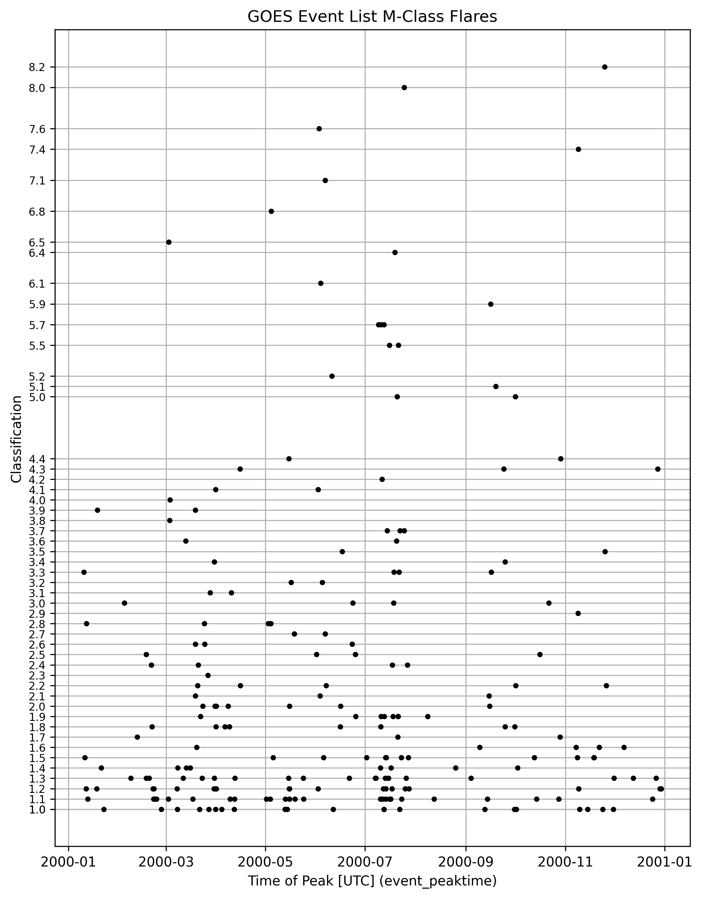

[Information on editing a Markdown document](https://docs.github.com/en/get-started/writing-on-github/getting-started-with-writing-and-formatting-on-github/basic-writing-and-formatting-syntax)

# Data

## Source

(1-2 paragraphs) Describe where the data came. If data are on-line, provide links.

## Interpretation

(1-2 paragraphs) Describe what is measured at a basic level. Provide links to 1-2 high-level descriptions (web pages or papers). This should be a text version of your two-minute overview.

# Exploratory Data Analysis

Provide 1-3 plots that characterize general features of the data. These plots will be revised as you project progresses. The first version should be of what you presented the first time.

Example of embedding image in Markdown.

# Statistical Test

## Description

Explain what you want to quantify with statistical methods. Provide references to any equations used.

You can use plain text for equations, e.g., y=mx+b, or LaTeX, e.g., $y=mx+b$.

## Results

Present the results of your analysis. Include tables and plots.

# References

Add references to any web page or paper that you read as you worked on this project.

Example:

* [Wheatland, 2000](https://iopscience.iop.org/article/10.1086/312739/pdf)

# Grading

Final project presentations, 4:30-7:10 pm in the same room as class. [Final Exam Schedule](https://registrar.gmu.edu/fall-2026-final-exam-schedule/)

Project presentations (10-20 minutes)

Guidelines:
1. Present exploratory data analysis results that are relevant to part 2.
2. Discuss question that you want to answer that requires statistical methods. Discuss related literature, if relevant.
3. Review theory
4. Present results related to question

You may use PPT or present from your README.md file.

Grading:
* All revisions discussed during previous class presentations addressed
* Theory correct
* Results correct
